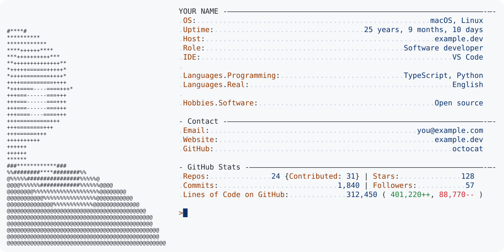

# profile-card-kit

Buat kartu README profil GitHub dari satu berkas konfigurasi: kartu bergaya neofetch dengan statistik GitHub langsung, tombol tautan pixel-art, dan grafik kontribusi Pac-Man dengan penghitung berjalan. Semuanya SVG, diperbarui tiap hari lewat GitHub Actions, dan mengikuti tema terang atau gelap pengunjung.

*English: [README.md](README.md)*

<picture>
  <source media="(prefers-color-scheme: dark)" srcset="./docs/preview/dark.svg">
  
</picture>

*Angka di atas hanya contoh.*

## Cara pakai

1. Buat repositori dengan nama yang sama persis dengan username GitHub-mu (ini menjadikannya README profil), lalu salin proyek ini ke sana, atau klik **Use this template**.
2. Edit [`profile.yaml`](profile.yaml): username, nama, baris info, kontak, dan tautan. [`examples/ranupane/`](examples/ranupane) adalah contoh lengkap.
3. Commit. Jalankan workflow **Update profile card** dari tab Actions (atau tunggu jadwal harian). Hasilnya ada di folder `output/`.
4. Tempel isi `output/snippet.md` ke `README.md`-mu.

Selama `github_username` masih `octocat`, workflow akan melewati dirinya sendiri, jadi salinan baru tidak pernah menerbitkan data contoh.

### Jalankan lokal

```sh
python -m venv .venv && . .venv/bin/activate
pip install -r requirements.txt

python -m profilecard build                      # render kartu, tombol, dan snippet (tanpa jaringan)
GITHUB_TOKEN=... python -m profilecard update    # ditambah statistik GitHub
python -m unittest discover tests                # tes offline
```

### Perintah

| Perintah | Fungsi |
|---|---|
| `build` | Membuat `output/neofetch`, `output/links`, dan `output/snippet.md`. Statistik yang sudah ada dipertahankan. |
| `stats` | Mengisi angka GitHub di kartu dari API. |
| `update` | `build`, lalu `stats`. |
| `pacman` | Menambah penghitung kontribusi ke `output/pacman/{dark,light}.svg`. |
| `ascii GAMBAR` | Mengubah potret menjadi ASCII art. Perlu `pip install -r requirements-ascii.txt`. |

Gunakan `-c lokasi/profile.yaml` sebelum perintah untuk memakai konfigurasi lain.

## Token

| Variabel | Fungsi |
|---|---|
| `GITHUB_TOKEN` | Disediakan Actions. Cukup untuk semua angka publik. |
| `ACCESS_TOKEN` | Secret opsional: personal access token (`repo`, `read:user`). Menambahkan repositori privat ke hitungan. |

Token hanya dibaca dari environment dan tidak pernah ditulis ke berkas. Cache jumlah baris di `cache/` memakai hash nama repositori, jadi nama repositori privat tidak bocor.

## Kredit dan lisensi

Tata letak kartu dan pendekatan statistiknya terinspirasi dari [README profil Andrew6rant](https://github.com/Andrew6rant/Andrew6rant). Gaya tombol terinspirasi dari profil [ignaciochiappero](https://github.com/ignaciochiappero). Animasi Pac-Man dibuat oleh [abozanona/pacman-contribution-graph](https://github.com/abozanona/pacman-contribution-graph), yang dipanggil workflow sebagai action. Lihat repositori masing-masing untuk lisensinya.

Lisensi proyek ini: [MIT](LICENSE).
