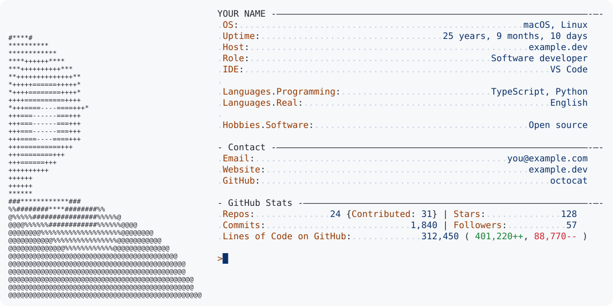

# profile-card-kit

Generate a GitHub profile README from one config file: a neofetch-style card with live GitHub stats, pixel-art link buttons, and a Pac-Man contribution graph with a running counter. Everything is SVG, refreshed daily by GitHub Actions, and follows the viewer's light or dark theme.

*Bahasa Indonesia: [README.id.md](README.id.md)*

<picture>
  <source media="(prefers-color-scheme: dark)" srcset="./docs/preview/dark.svg">
  
</picture>

<p><a href="#"><picture><source media="(prefers-color-scheme: dark)" srcset="./docs/preview/1-website_dark.svg"></picture></a><a href="#"><picture><source media="(prefers-color-scheme: dark)" srcset="./docs/preview/2-x_dark.svg"></picture></a><a href="#"><picture><source media="(prefers-color-scheme: dark)" srcset="./docs/preview/3-email_dark.svg"></picture></a></p>

*The numbers above are demo values.*

## Contents

- [Quick start](#quick-start)
- [Make your ASCII portrait](#make-your-ascii-portrait)
- [Configure](#configure)
- [Run it locally](#run-it-locally)
- [Troubleshooting](#troubleshooting)
- [How it works](#how-it-works)

## Quick start

You need a GitHub account. Nothing to install: GitHub Actions does the work.

**1. Create your profile repository.**
Click **Use this template** on this repo (or copy the files), and name the new repository **exactly your GitHub username**, for example `octocat/octocat`. GitHub shows that repo's `README.md` on your profile. It must be public.

**2. Edit `profile.yaml`.**
Set `github_username`, `name`, and the `info`, `contact` and `links` rows. Every field is commented in the file, and [`examples/ranupane/profile.yaml`](examples/ranupane/profile.yaml) is a complete real example. The workflows skip themselves while `github_username` is still `octocat`, so a fresh copy never publishes placeholder data.

**3. (Optional) Add your own ASCII portrait.**
Without one the card shows a neutral silhouette. See [Make your ASCII portrait](#make-your-ascii-portrait).

**4. Let the workflows push.**
Repository **Settings → Actions → General → Workflow permissions** → select **Read and write permissions** → Save.

**5. (Optional) Count private repositories.**
Public numbers work out of the box. To include private repositories, create a [classic personal access token](https://github.com/settings/tokens/new) with the `repo` and `read:user` scopes, and save it as a repository secret named `ACCESS_TOKEN` (**Settings → Secrets and variables → Actions → New repository secret**). Without it, stats cover public repositories only.

**6. Run the workflows once.**
Open the **Actions** tab and run **Update profile card**, then **Pacman contribution graph**, with **Run workflow**. After that they run every day on their own. They write the generated files to `output/` and a ready-made snippet to `output/snippet.md`.

**7. Put the snippet in your README.**
Replace the contents of `README.md` with the contents of `output/snippet.md`. The snippet shows the card, the link buttons, and the Pac-Man graph. Commit, then open your profile page. The Pac-Man image stays broken until its workflow has run once.

## Make your ASCII portrait

The card's left column is an ASCII portrait of up to **50 columns × 37 rows**. You have four options, from easiest to most hands-on.

**A. Do nothing.** A neutral silhouette is used.

**B. Convert a photo automatically.** Works best with a plain, even backdrop (a wall, a cloth, a studio sheet) and your face in the upper part of the picture.

```sh
pip install -r requirements-ascii.txt       # OpenCV + NumPy, only for this step
python -m profilecard ascii photo.jpg --auto > ascii.txt
```

`--auto` reads the backdrop colour from the photo's edges, removes it, and crops to your head and shoulders. The command prints the result, so it is also the preview: run it, read it in the terminal, change options, run it again.

**C. Fine-tune.** If the automatic result is off, steer it:

| Option | Use it when |
|---|---|
| `--crop x0,y0,x1,y1` | The framing is wrong. Pixel box on a 400×400 version of the photo; the box should be about 0.7 as wide as it is tall. |
| `--mask-hue 95,135` | The backdrop is one strong colour. OpenCV hue range 0–179 (blue is about 95–135, green about 40–80). Removes that colour only. |
| `--invert` | You are lit from behind, or the subject is bright on a dark backdrop. |
| `--auto --crop ...` | Keep the automatic backdrop removal but choose the framing yourself. |

Tips for the photo itself: use a square image, face centred, good light on the face, and no busy background. Glasses and beards come out well; fine hair detail does not, because the picture is only 50×37 characters.

**D. Edit by hand.** `ascii.txt` is plain text. Open it in any editor and tidy stray characters, or write your own art or a logo. Keep every line to 52 characters or fewer; a wider file is rejected with a clear message. More than 37 rows is fine: the card grows taller.

Then tell the config where it is, and commit:

```yaml
ascii: ascii.txt
```

The workflow does not run OpenCV. It only reads the finished `ascii.txt`, so the photo never needs to be in your repository. Keep the photo out of the repo if you prefer.

## Configure

Everything lives in [`profile.yaml`](profile.yaml).

| Field | What it does |
|---|---|
| `github_username` | Whose stats to show. Leave empty in Actions to use the repository owner. |
| `name` | Card title (uppercased). Defaults to the username. |
| `birthday` | Fills the `{uptime}` row ("22 years, 4 months, 16 days"). Remove it to hide that row. |
| `ascii` | Path to your portrait. Omit for the silhouette. |
| `info` | Rows under the title: `- Label: value`. A dot colours both halves (`Languages.Real`). `""` is a blank line. |
| `contact` | A second block headed "Contact", same row format. Remove to hide. |
| `links` | 1 to 5 pixel-art buttons. `type` is `website`, `x` or `email`; `label` is optional. |
| `output_dir` | Where generated files go. Default `output`. |
| `pacman_label` | Text before the Pac-Man counter. Default `Contributions`. |
| `colors` | Override colours per theme. Keys: `bg fg key value add dele cc` (and `flash` for the Pac-Man counter). |

Change the refresh time by editing the `cron` line in `.github/workflows/build.yaml` and `pacman.yaml` (times are UTC).

### Tokens

| Variable | Purpose |
|---|---|
| `GITHUB_TOKEN` | Provided by Actions. Enough for every public number. |
| `ACCESS_TOKEN` | Optional repository secret. Adds private repositories to the counts. |

Tokens are read from the environment only and never written to a file. The line-count cache in `cache/` is keyed by hashed repository names, so private repository names do not leak.

## Run it locally

```sh
python -m venv .venv && . .venv/bin/activate
pip install -r requirements.txt

python -m profilecard build                       # render card, buttons, snippet (no network)
GITHUB_TOKEN=... python -m profilecard update     # also fetch GitHub stats
python -m unittest discover tests                 # offline tests
```

| Command | What it does | Network |
|---|---|---|
| `build` | Renders `output/neofetch`, `output/links` and `output/snippet.md`. Existing stats are kept. | no |
| `stats` | Fills the card's GitHub numbers from the API. | yes |
| `update` | `build`, then `stats`. | yes |
| `pacman` | Adds the contribution counter to `output/pacman/{dark,light}.svg`. | yes |
| `ascii IMAGE` | Turns a portrait into ASCII art (see above). | no |

Put `-c path/to/profile.yaml` before the command to use another config. Use a token from `gh auth token` for a quick local run: `GITHUB_TOKEN=$(gh auth token) python -m profilecard update`.

## Troubleshooting

| Symptom | Fix |
|---|---|
| Workflow fails at **Commit** with `403` | Step 4: give the workflow **Read and write permissions**. |
| Workflow runs but does nothing | `github_username` is still `octocat`. Change it. |
| Stats show `0` or miss private repos | Add the `ACCESS_TOKEN` secret (step 5), then run the workflow again. |
| Pac-Man image is broken | Run **Pacman contribution graph** once. It needs `output/pacman/` to exist. |
| Card did not change after a run | GitHub caches images for a few minutes. Hard-refresh, or wait. |
| `config error: ... columns wide` | `ascii.txt` is wider than 52 characters. Regenerate it, or trim the lines. |
| `The ascii command needs OpenCV` | `pip install -r requirements-ascii.txt`. |

## How it works

```
profile.yaml            your configuration
profilecard/            the generator
  templates/            one module per look: neofetch, links, pacman
examples/               ready-made configs
.github/workflows/      daily refresh
output/                 generated SVGs (created by the workflows)
```

- **`neofetch`** draws the card. Dynamic numbers carry an `id`, and `stats` refills them from the GitHub GraphQL API. Lines of code are cached per repository and recounted only when a repository's latest commit changes.
- **`links`** draws the buttons. Each is its own image so it can sit in its own link; the gaps are drawn inside the images so the outer edges line up with the card.
- **`pacman`** post-processes the SVG made by [abozanona/pacman-contribution-graph](https://github.com/abozanona/pacman-contribution-graph): it reads when each square is eaten and adds a counter that rolls up in step. Pure SMIL, no JavaScript.

To add a new look, add a module under `profilecard/templates/` with a `render(cfg)` function and register a command in `profilecard/cli.py`.

## Credits

The button style is inspired by [ignaciochiappero's profile](https://github.com/ignaciochiappero). The Pac-Man animation is generated by [abozanona/pacman-contribution-graph](https://github.com/abozanona/pacman-contribution-graph), which the workflow calls as an action; see its repository for its licence.

## Licence

[MIT](LICENSE)
